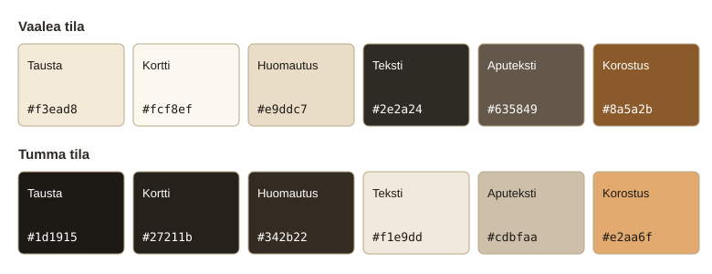
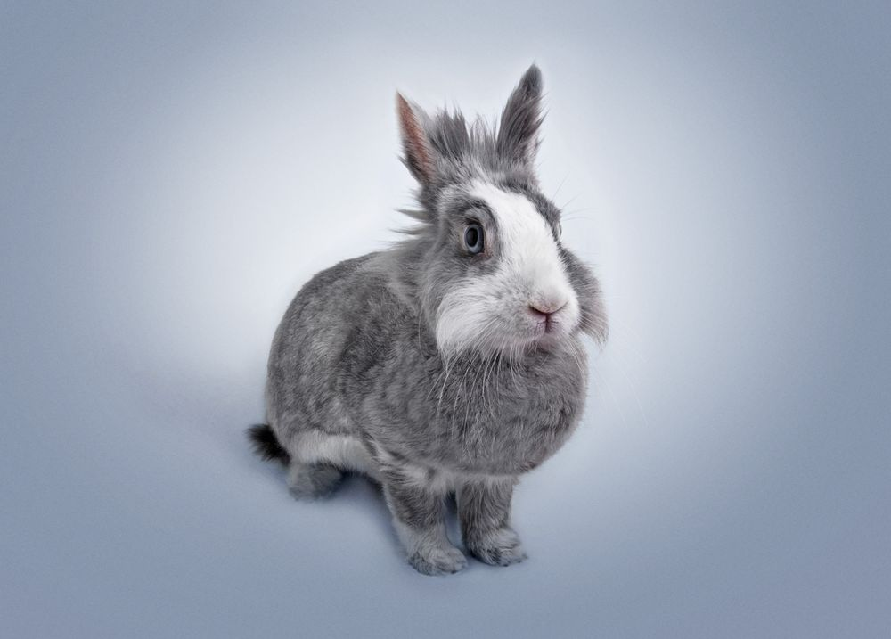

# Moodboard: Tassula ry

Tassula on vapaaehtoisvoimin toimiva eläinsuoja Seinäjoen lähellä. Sivuston tärkein tehtävä on auttaa eläintä löytämään koti, joten ilme on rakennettu eläinten ympärille: kuva ja tarina ensin, kaikki muu taustalla. Eläinsuojelun ei pidä näyttää kaupalta. Sivulla ei ole hintoja, alennusvärejä eikä "osta"-painikkeita, vaan kehotukset ovat "Tutustu eläimiin" ja "Aloita adoptiokysely".

## Tunnelma

**Lämmin.** Toimeksiannon "vanha paperi" värit muistuttavat puuta, nahkaa ja eläimen turkkia. Ne tekevät pienestä yhdistyksestä helposti lähestyttävän. Tummassa tilassa tausta on lämmin tummanruskea eikä musta, jotta sama tunnelma säilyy myös illalla.

**Kiireetön.** Adoptio on päätös vuosiksi, ei heräteostos. Väljät välit, isot kuvat ja lyhyet tarinat antavat kävijän pysähtyä yhden eläimen kohdalle. Sama viesti toistuu teksteissä: kysely ei sido, ja päätös tehdään rauhassa eläimen ehdoilla.

**Selkeä.** Yksi Tassulan vapaaehtoisista käyttää ruudunlukijaa, ja moni kävijä tulee puhelimella. Siksi puhelimella kaikki on yhdessä sarakkeessa, kontrastit ylittävät vaatimuksen reilusti ja fokus näkyy jokaisessa linkissä.

## Värit

Värit noudattavat 60–30–10-sääntöä: paperinvärinen tausta on noin 60 %, tummanruskea teksti ja eläinkuvat noin 30 % ja nahanruskea korostus noin 10 %. Korostus on varattu asioille, joita kävijän kuuluu painaa: linkeille, painikkeille ja valitulle suodattimelle.

### Vaalea tila

| Nimi | Heksa | Käyttö |
| --- | --- | --- |
| Vanha paperi | `#f3ead8` | Sivun tausta |
| Kerma | `#fcf8ef` | Eläinkortit ja lomake |
| Vaalea pahvi | `#e9ddc7` | Huomautuslaatikot |
| Tummanruskea | `#2e2a24` | Teksti ja tumma kehotusalue |
| Harmaanruskea | `#635849` | Aputekstit |
| Nahanruskea | `#8a5a2b` | Linkit, painikkeet ja korostukset |
| Tiilenpunainen | `#8c2721` | Lomakkeen virheilmoitukset |

Kontrastit:

- Leipäteksti taustalla 11.9 : 1 ja kortilla 13.5 : 1
- Aputeksti taustalla 5.8 : 1
- Linkki taustalla 4.9 : 1 ja kortilla 5.5 : 1
- Valkoinen teksti painikkeessa 5.9 : 1
- Virheteksti lomakkeella 8.2 : 1
- Teksti tummalla kehotusalueella 11.9 : 1

### Tumma tila

| Nimi | Heksa | Käyttö |
| --- | --- | --- |
| Tumma pähkinä | `#1d1915` | Sivun tausta |
| Kaarna | `#27211b` | Eläinkortit ja lomake |
| Tumma pahvi | `#342b22` | Huomautuslaatikot |
| Kermanvalkoinen | `#f1e9dd` | Teksti |
| Hiekka | `#cdbfaa` | Aputekstit |
| Karamelli | `#e2aa6f` | Linkit, painikkeet ja korostukset |
| Lohenpunainen | `#ffab9e` | Lomakkeen virheilmoitukset |

Kontrastit:

- Leipäteksti taustalla 14.5 : 1 ja kortilla 13.2 : 1
- Aputeksti taustalla 9.7 : 1
- Linkki taustalla 8.5 : 1 ja kortilla 7.7 : 1
- Tumma teksti painikkeessa 8.5 : 1
- Virheteksti lomakkeella 8.8 : 1
- Teksti kehotusalueella 12.2 : 1

Tummaa tilaa ei tehty kääntämällä värit. Briefin nahanruskea `#8a5a2b` olisi tummalla taustalla vain 3.0 : 1, joten sen tilalla on saman sävyn vaaleampi karamelli. Siksi painikkeen teksti vaihtuu tummassa tilassa valkoisesta tummaksi.

## Fontit

**Otsikot: Georgia.** Serif-fontti tuo painetun tiedotteen ja vanhan paperin tuntua, ja se on pehmeämpi kuin kulmikas groteski. Normaali paino ja tiivis riviväli pitävät isot otsikot rauhallisina, ei huutavina.

**Leipäteksti: Arial.** Selkeä pienissäkin koissa ja puhelimen näytöllä, ja se löytyy jokaisesta laitteesta.

**Miksi järjestelmäfontit.** Mitään ei tarvitse ladata hitaalla mobiiliyhteydellä, eikä kävijän IP-osoite siirry Googlelle niin kuin Google Fontsia käytettäessä. Fontteja on kaksi, ja kummankin perässä on yleinen varafontti (serif ja sans-serif).

**Koot.** Fonttikoot ovat remeinä, joten teksti kasvaa, jos kävijä on suurentanut selaimensa fonttikokoa. Pääotsikko skaalautuu `clamp()`-funktiolla 36 pikselistä 70 pikseliin näytön leveyden mukaan.

## Kuvat

Kuvat ovat Pexelsistä, ja niiden lisenssi ja tekijät on kirjattu KUVAT.txt-tiedostoon. Valintaperusteet: luonnonvalo, eläin lähellä ja katse kameraan tai sivulle, rauhallinen tausta. Kuvat on merkitty kuvituskuviksi, koska ne eivät ole oikeita Tassulan eläimiä.

Etusivun pääkuva on rajattu kaarevaksi ikkunaksi. Kaari tekee kuvasta sivun keskipisteen ja erottaa sen tavallisesta suorakulmaisesta kuvapankkikuvasta.

## Lähteet

- [HESY – Helsingin eläinsuojeluyhdistys](https://hesy.fi): Kotia etsivät eläimet ovat päävalikossa heti etusivun jälkeen. Eläinesittelyt kertovat luonteen lisäksi, millaiseen kotiin eläin sopii. Tästä tuli Tassulan korttien rakenne: kuva, laji, nimi ja tarina.

 [HESYn etusivu](images/moodboard/hesy.png)
 HESYn etusivu esittelee monta tapaa auttaa: lahjoituksen, jäsenyyden ja verkkokaupan sekä uutiskirjeen. Tassulalla on yksi päätavoite eli adoptio, joten sen etusivulla näkyy suoraan kolme kotia odottavaa eläintä.
- [SEY Suomen Eläinsuojelu](https://sey.fi): Sivustolla on erillinen saavutettavuustyökalu, josta voi valita esimerkiksi korkean kontrastin. Tassulassa perusulkoasu on itsessään riittävän kontrastinen molemmissa väritiloissa, joten erillistä työkalua ei tarvita. 
 
 [SEYn etusivu](images/moodboard/sey.png)
Jotenkin tämän sivun tumma kontrasti tekee sivusta miellyttävän. 

- [kodittomat.info](http://kodittomat.info): Kokoaa eri yhdistysten kotia etsiviä eläimiä yhteen. Kun eläimiä on paljon, kävijä tarvitsee tavan rajata niitä. Tassulassa riittää kevyt lajisuodatin.

[Kodittomat sivun etusivu](images/moodboard/kodittomat.png)
Sivun yksinkertaisuus pistää silmään ja pääsee suoraan asiaan. Pääsee heti katsomaan eläimiä, jotka voisi pelastaa.
